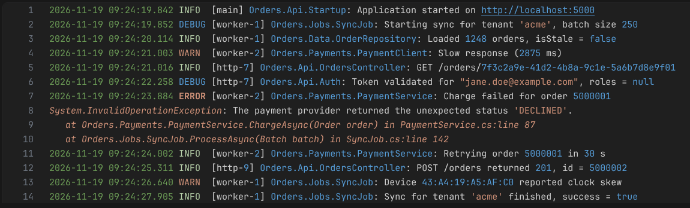
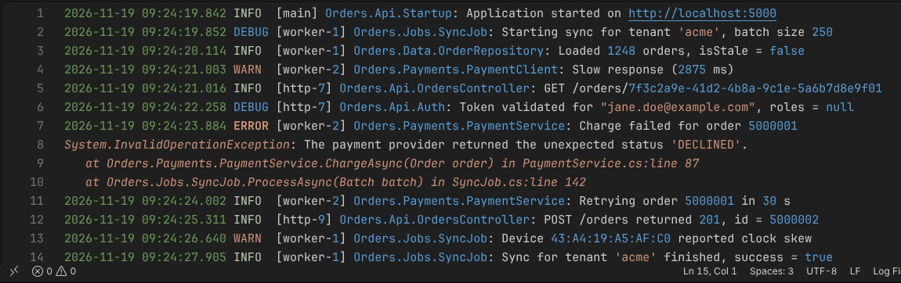
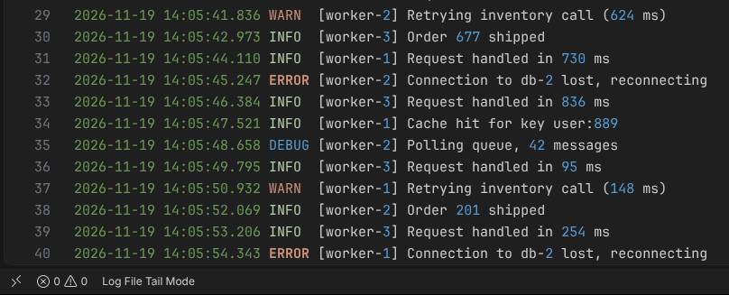
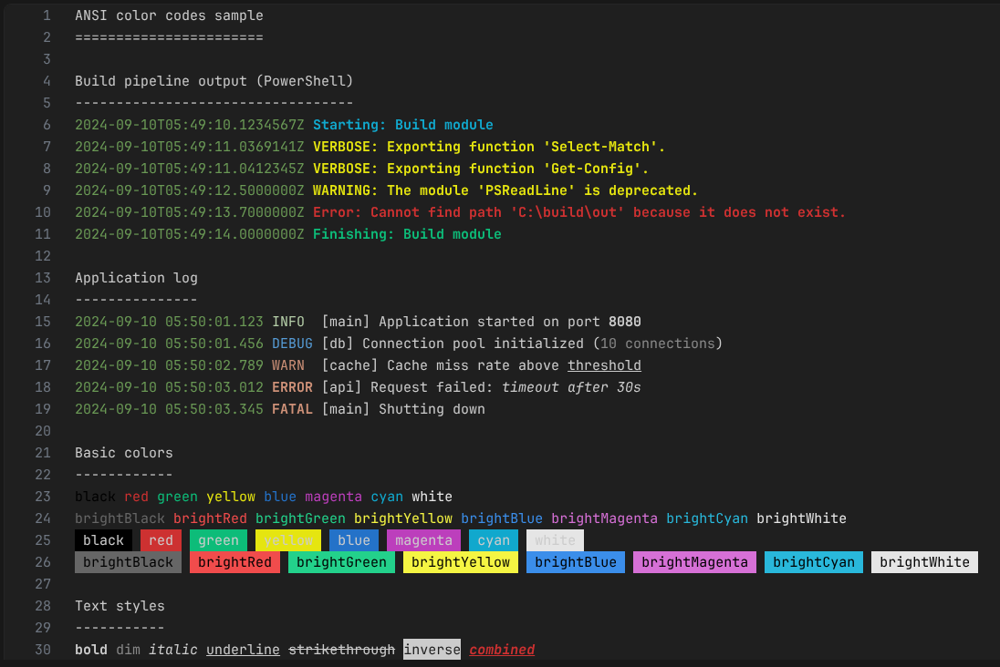
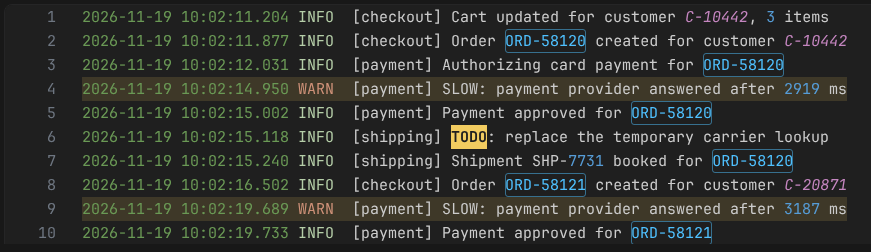
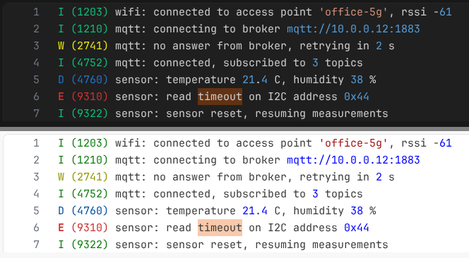
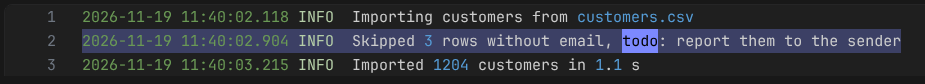
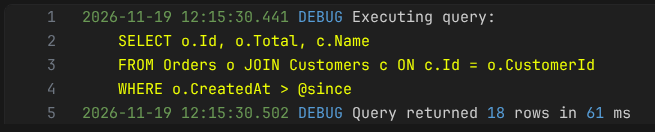

# Log File Highlighter

[](https://marketplace.visualstudio.com/items?itemName=emilast.LogFileHighlighter)
[](https://open-vsx.org/extension/emilast/LogFileHighlighter)
[](LICENSE)

Log File Highlighter adds colors to log files in VS Code, so that errors, warnings, timestamps and stack traces stand out from the rest. It works with most log formats out of the box and uses the colors of your theme.



## Features

- **[Highlighting](#highlighting)** of dates, log levels, exceptions, stack traces, numbers, strings, GUIDs, URLs and more.
- **[Time span of selected lines](#time-span-of-selected-lines)**: select some lines to see how much time they cover.
- **[Tail mode](#tail-mode)**: keep the end of a growing log file in view.
- **[ANSI colors](#ansi-color-codes)**: color codes from terminal programs are shown as colors.
- **[Clickable file paths](#clickable-file-paths)**: open a file at the line a log message points to.
- **[Your own patterns](#highlight-your-own-patterns)**: highlight anything you like, in any style.
- **[Theme colors](#use-the-colors-of-your-theme)**: your own patterns can follow your color theme.

## Getting started

Install the extension from the [Visual Studio Marketplace](https://marketplace.visualstudio.com/items?itemName=emilast.LogFileHighlighter), or search for "Log File Highlighter" in the Extensions view. For editors that use [Open VSX](https://open-vsx.org/extension/emilast/LogFileHighlighter) instead, such as VSCodium, Cursor and Windsurf, install it from there.

Then open a log file. Files ending with `.log` are highlighted, and so are files that VS Code doesn't otherwise recognize if their first line starts with a date, such as `2026-11-19` or `[2026-11-19`.

If a log file isn't highlighted, see [Troubleshooting](#troubleshooting).

## Highlighting

The extension recognizes the common parts of log lines and colors them with the colors of your theme:

- Dates and times, in ISO format (`2026-11-19 09:24:19.842`) and common local formats (`19.11.2026`, `11/19/2026 09:24`)
- Log levels, such as `ERROR`, `WARN`, `INFO`, `DEBUG` and `TRACE`, also in brackets and short forms like `[err]` or `[w]`
- Exceptions, exception type names and stack traces
- Numbers, strings, `true`, `false` and `null`
- GUIDs, MAC addresses, URLs and namespaces like `Orders.Api.Startup`

To change the colors, see [Change the colors](#change-the-colors).

## Time span of selected lines

Select some lines, and the status bar shows how much time passes between the first and the last of them. A bar under each timestamp shows where in that time span the line is. Press <kbd>Escape</kbd> to remove the bars.



The bars can be turned off with `"logFileHighlighter.enableProgressIndicator": false`, and their color changed with `logFileHighlighter.progressIndicatorUnderlineColor`.

## Tail mode

Scroll to the end of a log file, and the editor follows the file as new lines are added, like `tail -f`. The status bar shows `Log File Tail Mode` while it's active. Scroll up to stop it.



Tail mode can be turned off with `"logFileHighlighter.enableTailMode": false`.

## ANSI color codes

Log files from build pipelines, scripts and other terminal programs often contain ANSI color codes. The text is shown in those colors, and the codes themselves are hidden.



The 16 basic colors use the terminal colors of your theme. 256-color and 24-bit colors, bold, dim, italic, underline, strikethrough and inverse are supported too. Turn the feature off with `"logFileHighlighter.enableAnsiColors": false`, or show the codes with `"logFileHighlighter.ansiEscapeCodeDisplay"` set to `"dim"` or `"show"`.

## Clickable file paths

File paths in log messages and stack traces are links. <kbd>Ctrl</kbd>+click (<kbd>Cmd</kbd>+click on macOS) a path to open the file at the line and column after it:

| Format | Example |
| --- | --- |
| `path:line` and `path:line:column` | `D:\src\Orders\Program.cs:42`, `/home/me/app/src/server.ts:42:7` |
| `path(line)` and `path(line,column)`, as from compilers | `src\Orders\Program.cs(42,7)` |
| .NET stack traces | `in C:\src\Orders\PaymentService.cs:line 87` |
| Python stack traces | `File "/app/orders/payments.py", line 42` |

A path can be absolute, or relative to the folder of the log file or a workspace folder. It needs at least one folder, such as `src/app.ts`, and only paths to files that exist become links. Turn the feature off with `"logFileHighlighter.enableFileLinks": false`.

## Highlight your own patterns

Add your own patterns to the `logFileHighlighter.customPatterns` setting to highlight log levels of other logging frameworks, ids from your domain, or anything else. A pattern is a text or a regular expression, and each one can have its own style:

```jsonc
"logFileHighlighter.customPatterns": [
    // Order numbers, with a rounded border
    { "pattern": "ORD-\\d+", "foreground": "#4fc1ff", "border": "1px solid #4fc1ff80", "borderRadius": "3px" },
    // Customer ids, in italics
    { "pattern": "C-\\d+", "foreground": "#c586c0", "fontStyle": "italic" },
    // Whole lines about slow responses
    { "pattern": "SLOW", "highlightEntireLine": true, "background": "#f2cc6026" },
    // TODO notes
    { "pattern": "TODO", "foreground": "#1f1f1f", "background": "#f2cc60", "fontWeight": "bold" }
]
```



All the options and more examples are in the [custom pattern reference](#custom-pattern-reference).

### Use the colors of your theme

Instead of fixed colors, `foreground`, `background` and `overviewColor` can use a [theme color](https://code.visualstudio.com/api/references/theme-color), such as `terminal.ansiRed`. Your patterns then match your theme and change with it. Here are the same patterns in a dark and a light theme:

```jsonc
"logFileHighlighter.customPatterns": [
    { "pattern": "^E \\(\\d+\\)", "foreground": "terminal.ansiRed" },
    { "pattern": "^W \\(\\d+\\)", "foreground": "terminal.ansiYellow" },
    { "pattern": "^I \\(\\d+\\)", "foreground": "terminal.ansiGreen" },
    { "pattern": "^D \\(\\d+\\)", "foreground": "terminal.ansiBlue" },
    { "pattern": "timeout", "background": "editor.findMatchHighlightBackground" }
]
```



<details>
<summary>Theme colors that work well for log files (expand)</summary>

| Theme color id | Suitable for |
| --- | --- |
| `terminal.ansiRed`, `terminal.ansiYellow`, `terminal.ansiGreen`, `terminal.ansiBlue`, `terminal.ansiCyan`, `terminal.ansiMagenta`, and the `terminal.ansiBright...` variants | Log levels. All themes define them, and they're made to be readable on the editor background. |
| `editorError.foreground`, `editorWarning.foreground`, `editorInfo.foreground` | Errors, warnings and information, in the same colors as the squiggles in the editor. |
| `editor.findMatchHighlightBackground`, `editor.wordHighlightBackground` | Backgrounds that make text stand out while keeping it readable. |
| `descriptionForeground`, `disabledForeground` | Text that should be toned down, such as noise in the log. |

The complete list is in the [Theme Color reference](https://code.visualstudio.com/api/references/theme-color). To see the values of the current theme, run the command **Developer: Generate Color Theme From Current Settings**. VS Code's settings editor may warn about theme color ids, since it expects hex colors there. The warning can be ignored.

</details>

## Change the colors

The built-in highlighting uses the colors of your theme, which don't always fit log files. A theme might show `ERROR` in green, for example. You can set the colors of the log items yourself with the `editor.tokenColorCustomizations` setting:

```jsonc
"editor.tokenColorCustomizations": {
    "textMateRules": [
        { "scope": "log.error", "settings": { "foreground": "#f14c4c", "fontStyle": "bold" } },
        { "scope": "log.warning", "settings": { "foreground": "#cca700" } }
    ]
}
```

<details>
<summary>All log item scopes (expand)</summary>

`log.constant`, `log.date`, `log.debug`, `log.error`, `log.exception`, `log.exceptiontype`, `log.info`, `log.string`, `log.verbose`, `log.warning`

</details>

## Troubleshooting

<details>
<summary>A log file isn't highlighted (expand)</summary>

Other extensions can also add a language for `.log` files, for example [Gemini Code Assist](https://marketplace.visualstudio.com/items?itemName=Google.geminicodeassist). VS Code then uses that language instead. To switch the current file back, press <kbd>Ctrl</kbd>+<kbd>K</kbd> <kbd>M</kbd> (<kbd>Cmd</kbd>+<kbd>K</kbd> <kbd>M</kbd> on macOS), or click the language name in the status bar, and select **Log File (log)**. To always use Log File Highlighter for log files, add this to your settings:

```json
"files.associations": {
    "*.log": "log",
    "*.log.*": "log"
}
```

The `*.log.*` line also covers rotated logs like `app.log.1`. Files that start with a date are only detected when VS Code doesn't already know their extension, so a `.txt` file stays plain text unless you add `"*.txt": "log"`.

</details>

<details>
<summary>Large log files aren't highlighted (expand)</summary>

VS Code turns off highlighting for large files. To turn it back on for log files only, add this to your settings:

```json
"[log]": {
    "editor.largeFileOptimizations": false
}
```

</details>

## Custom pattern reference

<details>
<summary>All options of a custom pattern (expand)</summary>

| Option | Description | Examples |
| --- | --- | --- |
| `pattern` | **Required.** The text to highlight, or a JavaScript regular expression. Remember to escape special characters, e.g. `\\d` in JSON. | `TODO`, `ORD-\\d+` |
| `patternFlags` | Extra regular expression flags. The `g` and `m` flags are always used. | `i` (ignore case), `s` (`.` matches line breaks) |
| `highlightEntireLine` | Highlight the whole line that contains a match. | `true` |
| `foreground` | Text color: a CSS color, or a [theme color](#use-the-colors-of-your-theme) id. | `#ff5588`, `yellow`, `terminal.ansiGreen` |
| `background` | Background color, like `foreground`. | `#f2cc6026`, `editor.findMatchHighlightBackground` |
| `fontWeight` | CSS font weight. | `bold` |
| `fontStyle` | CSS font style. | `italic` |
| `border` | CSS border around the match. | `1px solid #4fc1ff` |
| `borderRadius` | Rounded corners of the border. | `3px` |
| `letterSpacing` | Space between the characters of the match. | `2px`, `-1px` |
| `textDecoration` | Extra CSS text decorations. | `underline`, `red wavy underline` |
| `overviewColor` | Show matches in the scroll bar (the overview ruler), in this color. | `yellow`, `editorError.foreground` |
| `overviewRulerLane` | Where in the scroll bar to show them. | `Left`, `Center`, `Right`, `Full` |

A pattern needs at least one of `foreground`, `background`, `fontWeight`, `fontStyle`, `border` or `borderRadius` to have any effect.

</details>

<details>
<summary>Several styles for the same text (expand)</summary>

A pattern can be used more than once with different styles, for example to highlight both a word and its line:

```jsonc
{ "pattern": "todo", "patternFlags": "i", "foreground": "#000000", "background": "#7d8aff" },
{ "pattern": "todo", "patternFlags": "i", "highlightEntireLine": true, "background": "#7d8aff50" }
```



</details>

<details>
<summary>Patterns that span several lines (expand)</summary>

With the `s` flag, `.` also matches line breaks, so a pattern can match text over several lines, such as an SQL statement. Use non-greedy quantifiers like `.*?`, so that a match doesn't run on to a later log entry:

```jsonc
{ "pattern": "SELECT.*?FROM.*?WHERE.*?$", "patternFlags": "si", "foreground": "#eeff05" }
```



</details>

## Support the project

Log File Highlighter is free and open source under the MIT license. If you find it useful and want to support further development, you're welcome to sponsor it, but that's completely optional 😊

[](https://github.com/sponsors/emilast)
<a href="https://www.buymeacoffee.com/emilast" target="_blank"></a>

Bug reports and ideas are welcome in the [issues](https://github.com/emilast/vscode-logfile-highlighter/issues).
